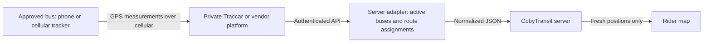

# A practical live GPS pilot for CobyTransit

Start with one SCPT-approved bus and one device. Before purchasing hardware, ask SCPT whether its buses already have an AVL/GPS system and whether it can supply an authorized feed. Reusing an agency feed avoids installing a second system.

A tracker is useful to this website only if its measured locations can reach a server API. Being able to watch it in the manufacturer's phone app is not sufficient.

## Hardware you can shop for

These are product categories/listings found online on November 12, 2026. Local stock, sellers, prices, subscriptions and API terms vary; no purchase or manufacturer compatibility test has been made.

| Option | Where to look | Fit for this project |
| --- | --- | --- |
| Dedicated Android phone, such as an unlocked Motorola Moto G Play, with a data plan and continuous power | [Walmart unlocked Motorola phones](https://www.walmart.com/browse/cell-phones/unlocked-motorola-phones/1105910_1073085_4219244_5877491) | Recommended for a small pilot: Traccar Client can send GPS to a server you control. Carrier-locked prepaid models require a compatible plan. |
| BrickHouse Spark Nano 7 or TrackPort OBD II | [Target GPS/vehicle trackers](https://www.target.com/s/car%2Btracker) | A dedicated-device option. BrickHouse advertises a [GPS API](https://www.brickhousesecurity.com/gps-trackers/API). Confirm that the exact device and subscription include API access and public display permission. |
| Tracki 4G/LTE GPS tracker | [Walmart Tracki listing](https://www.walmart.com/ip/462288513) | Requires cellular service/subscription. Tracki has [API information](https://omni.tracki.com/hc/help/articles/1739226619-ap); request the account's API terms, measurement timestamps and update cadence before buying. |

An AirTag or Tile-style Bluetooth finder is not a suitable continuous transit feed. Those products locate items through nearby devices and their own ecosystems; do not plan a bus website around a guaranteed 15–30 second update stream from them.

For an OBD device, have SCPT's fleet technician confirm the bus connector, voltage and compatibility. Many buses do not use a passenger-car OBD-II connector. A portable tracker or phone also needs an approved mount/power arrangement; do not install equipment on an agency bus without the operator's agreement.

## Recommended first version: an Android phone + Traccar

1. Agree with SCPT on one pilot bus, who manages its device, which routes it operates, and when its locations may be public. Use an agency device, rather than a driver's personal phone.
2. Obtain a compatible data plan, secure mount and continuous charger. Test cellular coverage on rural routes, especially the southern county towns.
3. Set up a private Traccar server or managed Traccar account with HTTPS. CobyTransit does not include or host this server. Create a separate device entry for each bus and restrict the website integration to the pilot fleet.
4. Install [Traccar Client](https://www.traccar.org/client/) on the phone and configure its device ID and HTTPS server URL. Aim for 15–30 second GPS updates and a similar stationary heartbeat. Allow the app's required background operation. Actual frequency varies with phone power settings, signal and the service plan; test it rather than assuming it.
5. Create a small server-side adapter that reads [Traccar's API](https://www.traccar.org/traccar-api/) and returns CobyTransit's normalized vehicle JSON. Use the position's actual GPS fix time, not its server-receipt time. Reject invalid/low-quality fixes and buffered old reports.
6. Maintain an active bus-to-route assignment: for example device 42 → public bus `SCPT-01` → route `2`. Devices can change routes during the day. Publish only active, assigned service vehicles; stop publishing at the end of service. Never infer a route solely from proximity to a route line.
7. Set the existing `SCPT_VEHICLES_URL` to the adapter's HTTPS endpoint and `SCPT_VEHICLES_TOKEN` to its secret bearer token. Store credentials only in the host's secret settings. See [LIVE_TRACKING.md](LIVE_TRACKING.md) for the exact contract and deployment requirements.
8. Verify location and route assignment with dispatch while the test bus moves, stops and loses signal. Test a turned-off phone, an expired measurement, buffered uploads, an incorrect assignment and the end of a shift. Expand the pilot only after the results are reliable.

The website already polls every 30 seconds while visible and removes measurements older than 90 seconds. A position is not an arrival prediction: accurate ETAs additionally require trip assignment, direction, stop sequence and delay calculations. Those predictions are not implemented.

## What to ask a device supplier

Confirm the exact model's API access, permitted public display, GPS fix timestamps, update/heartbeat interval, cellular coverage, continuous-power support, rate limits, and the **combined device + data + subscription/API cost**. An advertised low hardware price does not establish the recurring cost or integration rights. No subscription is purchased by this repository.

For a fleet deployment, prefer operator-managed devices and credentials, a provider SLA, alerting for offline devices, and a dispatch process for keeping route assignments correct.

Source documentation: [Traccar configuration](https://www.traccar.org/client-configuration/), [BrickHouse API](https://www.brickhousesecurity.com/gps-trackers/API), [Tracki API](https://omni.tracki.com/hc/help/articles/1739226619-ap). This is a setup proposal; no real device or agency feed has been connected.
